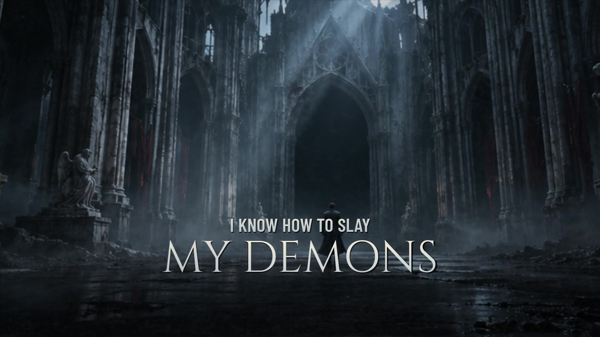

# DEMONS — SWAN

A complete 1920 × 1080, 30 FPS cinematic lyric-video production, built around the supplied `mixing Demons.m4a` recording.

[Download the rendered video and production bundle](https://github.com/nothatcher-creator/Lyricforge/releases/tag/demons-swan-2026-11-09)



**DEMONS**  
**SWAN**  
Music and Video by Carl Korytko  
Lyrics and Spoken Word by #WEED_SMOK

## Production

The Battle Within moves through moonlit abandoned architecture, a monumental cage, ancient inscriptions, crossed electrical wires, fragmented mirrors, closed doors, and an open landscape. Twelve generated environment plates support 43 timed camera setups. The production combines depth-dependent camera drift, moving fog, ghost wisps, rain, drifting ash, rotating ritual arcs, electrical interference, selective acoustic lighting, and actual rasterized 3D stone fragments during the solos. It is a layered 2.5D composite with limited procedural 3D elements; the environment plates are still artwork rather than generated live-action footage.

Cinzel, Barlow Condensed, and Cormorant Garamond provide the title, impact, and vulnerable lettering. Phrases enter in short groups, and words brighten against their aligned performance; `MY DEMONS` is staged separately inside full refrains. Readability takes priority over distortion.

The supplied AAC track is stream-copied in its entirety. It is not remixed, normalized, shortened, or replaced. The source container measures **368.059501 seconds**; the 30 FPS picture has **11,042 frames / 368.066667 seconds**, a difference of less than one frame. Decoder priming makes the effective decoded content 368.011625 seconds. See `technical_verification.json` for compressed AAC and decoded PCM equality checks.

## Lyric timing and limits

All **285 reference words**, in order, are represented in **73 lyric cues**. `SOLO` is never displayed as a lyric. The complete recording was analyzed; tempo is approximately **100–101 BPM**, with a measured beat grid and 30 Hz RMS, bass, midrange, treble, and onset curves. Recognition independently located vocal sections with small.en and medium.en models. The supplied lyric text was then aligned with medium.en attention/DTW, with independently recognized onsets and a 20 ms CTC comparison.

The recording supports **screams**, **soul**, and **for** in the three spelling examples. Other uncertain words keep the songwriter's supplied wording. Heavy accompaniment masks several sung phrases. The `review_note` entries in `lyric_timeline.json` identify those ambiguities; automatic alignment and source coverage do **not** prove frame-perfect performance timing. This cut has technical and frame-level checks, but still benefits from the songwriter's listening review before an official release.

The first solo occupies approximately **3:02–3:33.6**, and the closing instrumental follows the final refrain at approximately **5:38.2**. There are no invented solo lyrics. Opening titles and closing credits sit inside the existing music.

## Edit in LyricForge

After pulling this commit, run LyricForge normally. In **Projects → Import**, choose `productions/demons/DEMONS.lyricforge.json`. Its 285 measured word cues, acoustic analysis, 43 scenes, custom font, environment plates, and original recording reference the included `public/assets/demons-*` files. The project passes the application's actual `readProject` validator.

The editor project is a timing and environment companion. LyricForge's own composition renders its built-in effects; the exact custom cinematic composite is generated by `render.py` below. Editing the editor project does not automatically modify the independent Python render timeline.

## Reproduce the exact composite

Requirements: Python 3.11+ recommended, FFmpeg/FFprobe on PATH, and an EGL/OpenGL 3.3 implementation. Mesa llvmpipe was used for the delivered render. Model weights are unnecessary for rendering because the measured analysis and timeline are included.

```sh
cd productions/demons
python -m venv .venv
. .venv/bin/activate
python -m pip install -r requirements.txt
python check_project.py
python render.py --output renders/picture.mp4
python mux.py --picture renders/picture.mp4 --output renders/DEMONS_SWAN_1080p.mp4
ffmpeg -v error -i renders/DEMONS_SWAN_1080p.mp4 -f null -
```

To inspect stills or render an excerpt:

```sh
python render.py --stills 10 78.7 138 185 337.7 361
python render.py --start 73 --duration 12 --output renders/preview-picture.mp4
```

`render.py` produces picture only; `mux.py` adds the complete original recording and checks both AAC packet-content and decoded PCM hashes. Use the full-length picture for the full-length mux command. `lyric_timeline.json` edits timing, `shots.json` edits camera setups, `visual.frag` edits atmosphere, and `render.py` edits typography and procedural geometry.

The SRT/LRC sidecars allow timing reuse in other software. Original supplied lyrics remain in `LYRICS_original.txt`. Font license files are included beside the fonts. Generated scenery is new artwork for this production; song and credit ownership remain with the credited creators.
