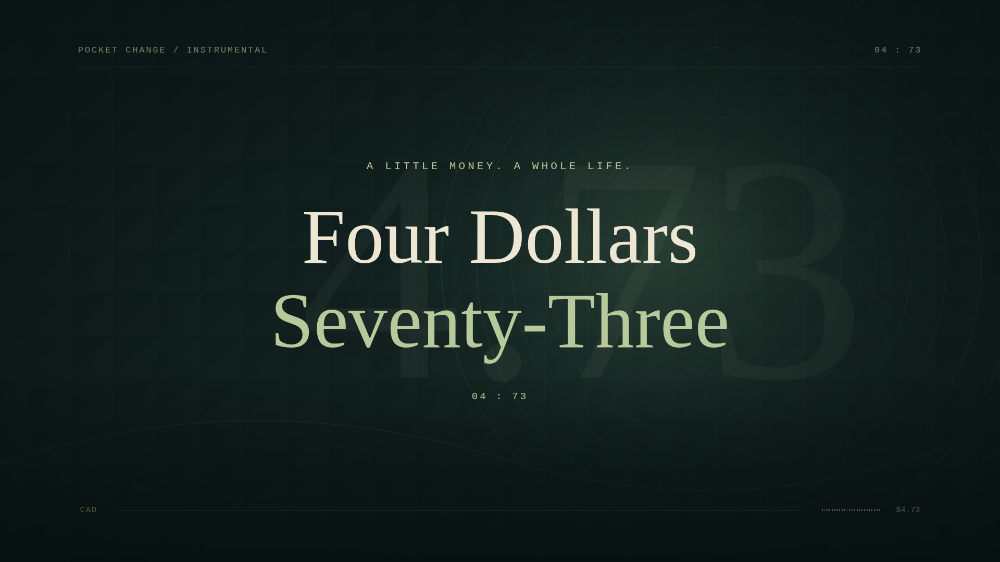

# Four Dollars Seventy-Three

[Download the complete 1080p video](https://github.com/nothatcher-creator/Lyricforge/raw/refs/heads/production/four-dollars-seventy-three/productions/four-dollars-seventy-three/Four-Dollars-Seventy-Three.mp4) · [Studio source ZIP](./Four-Dollars-Seventy-Three-studio-source.zip)



Approved jazz-finance treatment, November 8, 2026. Full supplied recording, 16:9, 1920×1080, 24 fps, H.264 / AAC stereo. No artist name was supplied for this song; none was invented.

## Contents

- `Four-Dollars-Seventy-Three.mp4`: complete rendered video (included in this directory).
- `Four-Dollars-Seventy-Three.srt`: editable phrase cues.
- `project.json`: complete editable production; all supplied lyric wording is preserved.
- `captions.json`: word timestamps with acoustic confidence where available.
- `treatment.md`: approved visual treatment.
- `qc.json`: preflight findings and known timing limitations.
- `studio-source.zip`: standalone React/Remotion source for reproduction; the original song is not redistributed separately.

## Reproduce

Extract the source ZIP. Install Node 22+, Python 3, FFmpeg and Chromium. Place your original MP3 at `public/media/four-dollars-seventy-three.mp3`, then run:

```sh
npm ci
node server/prepare-song.mjs
npm run dev
```

Open http://localhost:3100, use Open → four-dollars-seventy-three.json. Keep the server running. In another terminal:

```sh
npx tsx server/film-render.ts final
```

The original upload is unchanged. The render master applies `volume=0.68` (approximately −3.35 dB) to provide encoding headroom. Analysis reported a decoded mono peak above full scale; this is not proof that the source was audibly clipped. No time stretching or resampling of song duration was applied.

## Visuals

Original deterministic SVG illustrations: grocery perspective, printed expense receipt, upright bass and saxophone, moonlit window and lamp. Frame-driven camera drift, slow pushes, geometric currency motifs, speech emphasis and word highlights. Local fonts keep rendering independent of third-party font servers.

## Synchronization limits

The recording was processed with local Whisper small.en and a pinned quantized wav2vec2 CTC forced aligner. Independently transcribed section anchors constrain the CTC alignment so instrumental regions cannot absorb entire phrases. The supplied lyrics remain authoritative; Whisper's misheard alternatives are not printed.

132 word cues have low acoustic confidence or explicit review flags, often short function words against music. The synthetic opening bank voice, “Nice,” and final phone/response dialogue are especially uncertain and require a listening review. The output is a complete first cut, not a claim of frame-perfect manually verified vocal alignment. Sustained words may need end-time adjustments. Instrumental passages and the full tail of the recording are retained. Bracketed stage directions drive the structure and are not printed as sung text.

The beat grid uses an 85.7 BPM half-time interpretation of the automatic onset estimate. The graphic pulse is intentionally restrained; this grid is an estimate rather than a verified musical score.

## Fonts

Liberation Serif and Liberation Mono (SIL Open Font License); Open Sans (Apache 2.0 distribution on this host). Original notices accompany the source package. The project does not imply third-party endorsement.

## Verified final file

H.264 1920×1080 at 24 fps; 5,385 video frames; stereo 48 kHz AAC. Container duration 224.426667 seconds includes encoder padding. Audio/video start difference is zero. Full decode found no errors; decoded AAC peak is −3.155 dBFS. All 78 lyric midpoint layouts were checked in Chromium; eight automated tests and the TypeScript build passed. See `verification.json` and the [rendered contact sheet](contact-sheet.png).

The complete video and source archive are included directly on this production branch.
