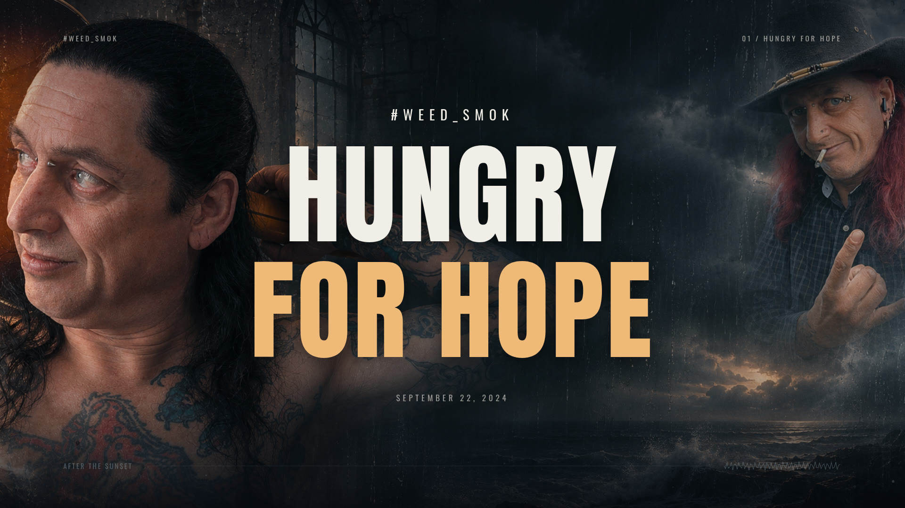

# Hungry For Hope — #WEED_SMOK

[Download the full 1080p MP4](https://github.com/nothatcher-creator/Lyricforge/raw/refs/heads/production/hungry-for-hope/productions/hungry-for-hope/Hungry-For-Hope.mp4) · [Studio source ZIP](Hungry-For-Hope-studio-source.zip)



Song date supplied: September 22, 2024. Full recording; 1920×1080, 24 FPS, H.264 and 320 kbps stereo AAC. A complete directed first cut with supplied wording and repeated passages matched to the recording.

## Art direction

Three genuine generated environment images plus a photographic portrait composite were created specifically for this production with image_gen. Their original generated PNGs and a SHA-256 manifest are included: the storm coast, the fractured cathedral, the amber-lit aperture, and a portrait composition derived from both reattached artist photos. They are animated as image plates with camera movement, crossfades, rain/ash/dust, atmospheric light and a measured audio waveform. No generated video footage or filmed performance is claimed.

Anton creates heavy condensed hook declarations; Oswald carries the verse. Hook nouns are layered with a fine outline echo, entered near their vocal cue, then driven by damped bass and measured impact pulses. Individual verse words use mask reveals and smaller impact accents. Typography settles into readable poses between movements. Fonts are bundled under the SIL Open Font License, with license notices in the source.

## Synchronization

Local Whisper small.en supplies an independent lyric/timing check. Its default VAD failed to detect the singing; a second run without VAD located the vocal passages. A pinned wav2vec2 CTC aligner was constrained by section and phrase windows derived from that pass. The supplied words were retained instead of replacing them with Whisper's mishearings.

The recording appears to repeat the six-line “Replace” verse around 1:03–1:27 and its last three lines around 1:46–1:55, beyond the pasted sequence. Clarification was offered. The stated default was to reuse the supplied lines for those audible repetitions; no new lyric wording was invented. The editable project preserves the original pasted lyrics separately and records each added repetition in `qc.json`.

The final timeline contains 53 phrase cues / 213 words. Acoustic confidence is low on much of this musical mix, so word timestamps remain explicitly flagged for listening review. These are constrained estimates, not a claim of manually verified frame-perfect singing alignment. Phrase windows were compared against the independent transcript. Some word endings, vocal ad-libs and alternate pronunciations may need revision.

Rhythm uses 16 kHz PCM RMS, 35–180 Hz bass energy, spectral-flux transients, a tempo autocorrelation estimate of 107.14 BPM, and a transient-snapped grid. Stronger impact events use a refractory interval so the picture does not react chaotically to every transient. This is not semantic instrument recognition or a verified tempo map.

## Portraits

Both original portrait references were reattached by the user during production and incorporated into a generated editorial composite. The two photographed poses remain separate source moments. The composite is used in the introduction, quieter passages and ending; it is not presented as filmed performance footage.

## Audio

The original MP3 was used directly; its content, duration and level were preserved before the final AAC encode. Decoded source peak was approximately −6.10 dBFS. No gain or time stretch was applied.

## Reproduce

Unzip the standalone studio source. Install Node 22+, FFmpeg and Chromium. Place your original recording at `public/media/hungry-for-hope.mp3`; the raw uploaded song is not redistributed separately.

```sh
npm ci
npm run dev
# In a second terminal:
npx tsx server/render-hope.ts final
```

Open http://localhost:3100 → Open → hungry-for-hope.json for the editable preview. Rendering and preview share the same Remotion composition. `server/render-hope.ts poster` creates a title image; `server/qc-hope.py` verifies the finished media. Local speech models are optional for replaying a saved project; corrected timestamps are already serialized.

## Delivery

The MP4, generated images, font licenses, editable JSON, SRT, word-cue JSON, source ZIP, poster, contact sheet and verification report are delivered on the `production/hungry-for-hope` branch of the existing Lyricforge repository. Existing application files are preserved.

## Final verification

The final portrait-integrated MP4 contains 4,245 frames at 1920×1080 / 24 FPS. The full decode reported no errors; audio/video starts are aligned. See `verification.json`, `layout-check.json` and the [rendered contact sheet](contact-sheet.png). Twelve automated tests and the production build passed. Word timings remain flagged for listening review.
